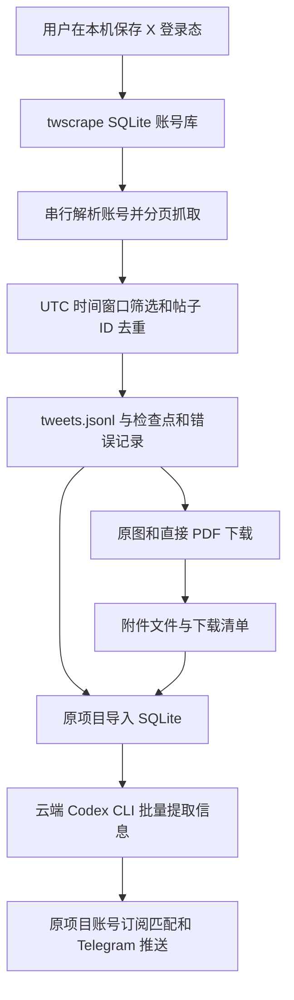

# X 抓取方案说明

本说明依据 2026-10-24 读取的 Investor Watcher 本地代码整理。它记录代码行为，不代表当天已重新验证生产进程、X 登录有效性或线上抓取成功率。

## 2026-10-28 实际验证与修复

云端轮询服务仍在运行，但最近两轮采集日志每轮出现 72 次 `Failed to parse scripts`，同时仍报告 `status=ok`、新增 0 条。原因是 0.18.1 和项目旧补丁只能处理旧网页脚本格式，且底层中止请求后返回空结果，采集器没有识别失败。

修复后依赖为 `twscrape==0.20.1`。停用原签名解析补丁，采用上游当前 x-web 格式解析；增加版本检查，将中止请求、缺少 data 的响应和无有效数据的错误响应转为异常，并将失败模式标记为未完成。部分失败返回非 0；最多等待账号冷却 60 秒而不清锁；提前停止时显式关闭异步流。

本机实际验证成功读取 Jukan 账号资料、5 条正文（其中一条长度 1,740 字符）、3 条账号搜索结果，并以 `name=orig` 下载一张 72,044 字节 PNG。本次样本没有直接 PDF 链接，未据此宣称 PDF 下载链路或 12 个账号全量覆盖均已验证。真实 Cookie、样本正文、账号库和原图保留在私密数据目录，不纳入开源提交。

以下章节中提到 0.18.1 和旧版返回行为的部分，用于解释原项目方案；当前应安装 0.20.1，不再使用旧补丁。默认 `TWS_TELEMETRY=0`，关闭库的使用统计上报。

### 同次依赖升级

按运行时依赖关系核对了 15 个包，统一固定在 Skill 自带的 `requirements.txt`；本机 Python 3.13 与云端 Python 3.12 使用同一组版本。除了 `twscrape 0.18.1 → 0.20.1`，还有 `certifi 2026.5.20 → 2026.10.23`、`beautifulsoup4 4.14.3 → 4.15.0`、`soupsieve 2.8.4 → 3.0.4`、`anyio 4.13.0 → 4.15.1`、`idna 3.16 → 3.20`、`pyotp 2.9.0 → 2.10.0`、`typing-extensions 4.15.0 → 4.16.0`，并补齐新版所需 `py-machineid 1.0.0`。其余依赖核对后已是当前版本。

Twikit、Scweet 和独立 XClientTransaction 没有进入当前生产抓取流程，不因依赖升级自动安装到生产或切换抓取方式。云端 Codex CLI 不在此次用户确认的升级范围内。

SoupSieve 3.0.4 要求 Python 3.11.5+，因此完整新版本清单不再兼容 Python 3.10。生产 Python 3.12 与本机 Python 3.13 满足要求，安装说明已同步更新。

完整依赖升级后，云端以现有登录态运行单账号最近 20 分钟采集，成功保存 2 条新帖、错误数 0、退出码 0；Web、X 轮询和新闻轮询服务均处于运行状态。验证在生产轮询锁内串行执行，先备份原脚本、依赖清单和账号库；没有清空限流锁，没有重跑历史消息或调用下游分析。

## 一、当前项目的实际方案

项目以 `twscrape==0.18.1` 为主，通过已登录 X 的 Cookie 建立本地 SQLite 账号库。不是浏览器逐条点击，也没有将 Twikit、Scweet 作为并行运行的生产抓取器。源码保留官方 X API v2 的备用路径，但该路径可能计费，开源提取版禁止自动调用。



开源包提供 A 到 G。H 到 J 为原产品的业务处理层，只描述接口，不包含部署凭据或启动这些服务。

### 原项目代码对应

| 原项目文件 | 实际职责 |
| --- | --- |
| `scripts/collect_x_tweets_90d.py` | 时间窗口、账号解析、四种抓取模式、去重、检查点、错误与覆盖报告 |
| `scripts/download_x_attachments.py` | 从已存帖子提取媒体和直接 PDF 候选，下载并写清单 |
| `scripts/run_x_watchlist_poll.sh` | 串行执行抓取、下载、导入和分析；默认滚动 20 分钟 |
| `scripts/run_x_watchlist_poll_loop.sh` | 每轮完成后等待 600 秒再执行 |
| `config/com.investorwatcher.xpoll.plist` | macOS 调度示例，`StartInterval=600` |
| `scripts/run_x_watchlist_job.sh` | 独立历史 90 天任务，不是新增监控必经步骤 |
| `scripts/import_local_x_archive.py` / `investor_watcher/local_archive.py` | 将 JSONL 和附件关联导入产品 SQLite |
| `investor_watcher/service.py` / `analyzer.py` / `research.py` | 待分析帖子分批请求云端分析；默认每批 20，范围限制 1–50 |

原项目分析失败时可退回逐条请求，这是可配置行为，不应描述成绝不出现单条调用。生产可要求 Codex 分析成功，避免静默发布本地规则结果。原项目目前的轮询脚本默认 `X_POLL_NOTIFY=1`，不是旧 README 所说的固定 `notify=false`。抓取层不以投资关键词预先丢弃帖子，是否有投资信息及是否喊多/喊空由下游分析处理。

本地轮询列表包含 12 个账号：`aleabitoreddit`、`qinbafrank`、`jukan05`、`nft_hu`、`LinQingV`、`starzq`、`RihardJarc`、`GavinSBaker`、`gurgavin`、`nongaap`、`MicroCapClub`、`iancassel`。公开版不内置这份名单，由调用方提供。

## 二、登录态与限流

登录凭据来自使用者自己的浏览器会话，至少需要 `auth_token` 和 `ct0`。初始化通过 `API(...).pool.add_account(...)` 导入，只在本机保存，不需要用户密码或邮箱密码。文件和账号库不能发布到 GitHub。

先用账号 ID 获取/缓存账号资料，获取失败但已有缓存时继续使用缓存 ID。采集依次处理账号和模式，没有自行开多线程并发。库负责端点限流锁与冷却，脚本另加随机等待。

| 参数 | 原项目新增轮询 | 原项目历史任务 |
| --- | --- | --- |
| 每扫描多少条后考虑等待 | 50 | 75 |
| 批次等待 | 5–15 秒 | 30–75 秒 |
| 模式间等待 | 15–45 秒 | 90–210 秒 |
| 账号间等待 | 5–20 秒 | 180–420 秒 |
| 旧帖停止阈值 / 最小扫描数 | 20 / 20 | 500 / 500 |

旧帖停止计数是累计值，不是“连续旧帖”计数；循环中的部分提前 `continue` 路径也会跳过批次等待，因此它不是精确的每 N 条网络限速器。随机等待不能保证账号不会受限。

原脚本目录锁用于避免重复任务；开源入口使用系统文件锁，同时锁定账号库对应锁文件和输出目录。进程退出会释放文件锁，锁文件留存不代表任务仍存活。多台机器共享同一登录态，或绕过入口直接运行底层脚本，不能依靠这些本机锁防并发。

## 三、时间窗口、检索与续跑

- `--lookback-minutes 20`：以启动时 UTC 当前时间为结束，开始为向前 20 分钟，筛选条件为 `start <= date < end`。
- `--days 90`：使用日期日界线，默认从本机“今天减 90 天”日期的 UTC 零点，到次日 UTC 零点；不是精确滚动 90 天。以 `run_metadata.json.window` 为准。
- `--since` 与 `--until`：明确 UTC 日期边界，`until` 为不包含的结束日期。
- timeline、replies、media 是取账号分页列表后在本地筛日期；只有 search 会把 `from:`、时间和额外检索条件发送给搜索接口。不能把 timeline 描述为服务端只请求 20 分钟的数据。
- timeline 使用 `user_tweets`；replies 使用 `user_tweets_and_replies`，因此两个模式可能重叠；media 使用 `user_media`；search 使用 `search`。
- 检查点以抓取器、handle、模式为键，没有绑定时间窗口，也不记录可恢复的 twscrape 页游标。重新开始会重扫并按 ID 去重，并非从断点页接着读。
- 原轮询用 `--force` 重新扫描窗口；它只忽略“该模式已完成”的检查点，不会删除旧帖子、绕过限流或重置额度。开源 `run/watch` 同样如此。

每次写入 `tweets.jsonl` 之前检查全局帖子 ID。重复 ID 只写入 `duplicate_tweets.jsonl`，不更新原帖正文和互动数；重复模式只保留首次来源。因此这是一份去重档案，不是持续刷新每条帖子的统计表。

固定窗口与间隔重叠只能缓解短延迟。如果单轮运行加等待已超过 20 分钟，或停机超过窗口，可能漏掉期间帖子。新增监控不自动扩大成 90 天重抓，补抓范围应单独确定。

## 四、保存的数据

| 文件 | 内容与含义 |
| --- | --- |
| `tweets.jsonl` | 去重的帖子对象及 source/handle/mode/query |
| `duplicate_tweets.jsonl` | 遇到重复 ID 的时间和来源，不是重复正文 |
| `errors.jsonl` | 账号解析和模式抓取错误；跨轮累积 |
| `users.json` | 接口返回/缓存的账号资料 |
| `checkpoints.json` | 账号与模式的最近进度摘要 |
| `raw_pages.jsonl` | twscrape 路径是模式摘要，不是原始 GraphQL 分页响应 |
| `run_metadata.json` | 最近一轮窗口、参数和结果；会被下一轮覆盖 |
| `completeness_report.json` | 整个归档的统计与当前检查点，不能证明全量 |
| `last_run.json` | 开源入口最近一轮抓取、下载退出码及结束时间 |

帖子示意（所有值为虚构）：

```json
{
  "collector": "twscrape",
  "source": {"name": "example", "handle": "example", "primary_source": "twscrape"},
  "handle": "example",
  "mode": "timeline",
  "query": null,
  "tweet": {
    "id": 123,
    "id_str": "123",
    "date": "2026-10-24T00:00:00+00:00",
    "rawContent": "示意正文",
    "url": "https://x.com/example/status/123",
    "links": [],
    "media": {"photos": [], "videos": [], "animated": []}
  }
}
```

原始库对象可能包含长推、引用帖、转推、回复关系、图片 URL 和视频变体；仅保留实际返回的字段，不再逐帖抓详情或补全整串线程。已删帖、账号无权访问的内容、接口没返回的长文不能据此恢复。JSONL 没有格式转换成 HTML 摘要，但仍不同于完整网络响应。

## 五、附件下载

下载器读取归档中顶层 `tweet.media` 的 photos/videos/animated，并扫描顶层 `tweet.links`。嵌套引用、转推里的媒体不递归遍历；若报告只在引用帖或文章页里，可能没有被下载。

- X 图片 URL 优先加 `name=orig`；预设候选还包括 `large`、`4096x4096`、无参数 URL。
- **当前实现遇到任一 HTTP 4xx 会直接结束候选尝试**，例如 orig 返回 404 时不会保证改抓 large；原图失败回退不是全覆盖。
- PDF 通过展开 URL 是否匹配 `.pdf`（允许 query/fragment）识别。重定向目标才是 PDF、文章内嵌下载按钮、无 `.pdf` 后缀链接或需其他网站登录态的报告不自动发现。
- 不把 X Cookie 转发给外部报告站点；外站受限返回 401/403 时记录失败。
- 默认不抓视频；显式调用下载器 `--include-videos` 才选返回变体中码率最高的项，未保证该项为 MP4。animated 默认可能只是预览图。
- 单文件限制、超时和递增重试；先写 `.tmp` 再原子替换。相同目标存在且非空时跳过，并非对文件作完整校验。
- PDF 当前没有 `%PDF-` 文件头和内容类型强校验；HTTP 200 返回登录 HTML 的情况下可能被当作下载成功，重要报告需额外检查内容。

文件保存在 `images/`、`pdfs/`，可选 `videos/`；命名为 `handle_帖子ID_URL哈希.后缀`。清单为 `attachment_manifest.jsonl`，失败写 `attachment_errors.jsonl`，均跨轮累积。

manifest 记录 `tweet_id`、`handle`、`kind`、`url`、`local_path`、`status`、`bytes`、`content_type`；回退时还可能有 `download_url`。下载成功不等于报告已被理解或 OCR（图片文字识别）完成。

`--skip-existing-manifest` 避免重复清单行；`--dry-run` 虽不下载，但会写候选到清单，必须用临时输出目录，不能混入正式成功清单。默认下载器每轮重读整个归档，随着历史累积耗时和内存都会增加。

## 六、完整性与故障判断

需要同时核对：进程是否存活、文件修改时间、错误新增数量、当前模式结果、窗口起止与最早/最新帖子时间、账号限流锁、附件清单与实际文件。不把“0 条新增”直接解释成正常无新帖。

原项目采集器在 `partial` 时可能仍以 0 退出；公开版改为遇到部分失败或未完成模式返回非 0，但这仍只能反映本轮接口遍历情况。`stream_end` 可能只是 X 没再返回数据；`old_window_stop` 是启发式停止（根据旧帖数量推测可以停止），都不能证明没有遗漏。

报告还有这些限制：归档总数和日期范围统计包含旧轮数据；`window_start_reached` 的逻辑与“只保存窗口内帖子”不等价；媒体字段为字典时 `len(media)` 数到的是分组键数，不是图片总数。准确附件数量以清单和文件为准。

登录失败、限流、网络失败和解析故障应分别报告。库的限流等待可能让任务很久没有新输出，需结合冷却时间判断。不要自动清锁或重置额度。

## 七、开源提取的适配与复用

保留采集与附件保存实现，去掉私人默认关注名单和产品导入依赖。新增薄入口负责本机 Cookie 导入、任意账号参数、单进程锁、轮询和状态查询；抓取逻辑不另写一套。

公开版固定 `--source twscrape`，拒绝 auto/xapi；默认只扫 timeline。默认关闭自动 JSONL 修复，损坏文件会报错而不是自动删行。原始脚本中保留部分官方 API 函数仅用于对照来源，不会被正常入口执行。

其他项目读取 `tweets.jsonl` 后，以帖子 ID 建唯一键；附件用 `tweet_id` 关联。若需要信息提取，将本次新增记录组成带稳定 ID 的批次交给独立分析器，逐 ID 保存结果，失败批次明确重试。该分析环节是否产生费用需由使用者授权，开源采集入口不会启动它。

仓库内的自动化测试使用临时目录、虚构帖子和模拟下载响应，不访问真实 X；实际登录态验证另行在私密目录完成，范围见本页开头。两者都不能证明所有历史帖子或外站附件完整。

## 八、上游参考

- [twscrape 官方仓库与使用说明](https://github.com/vladkens/twscrape)：登录态、抓取接口和账号冷却机制。
- 本包最初提取的依赖快照为 0.18.1，2026-10-28 修复后锁定为 0.20.1；上游主分支仍可能继续变化，以固定版本代码和实际验证为准。
